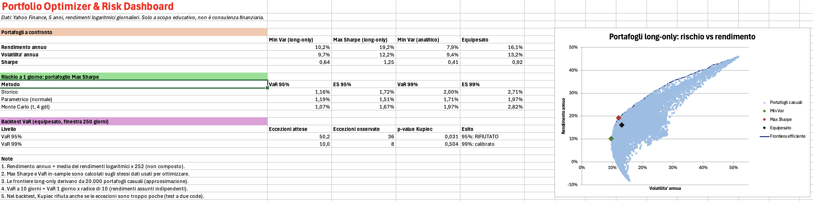

# Portfolio Optimizer & Risk Dashboard (Excel/VBA)

An Excel/VBA tool for portfolio optimisation and market-risk measurement on a 10-asset, multi-sector universe (equities, gold, long-term Treasuries). Prices are downloaded with a small Python helper, everything else is computed in VBA.

## What it does

- **Data**: 5 years of daily adjusted prices (Yahoo Finance), log-returns, annualised return/volatility/Sharpe per asset
- **Covariance and correlation matrices** with a correlation heatmap
- **Optimiser**: 20,000 random long-only portfolios, minimum-variance and maximum-Sharpe portfolios, efficient frontier, plus the analytical (unconstrained) minimum-variance solution via matrix inversion
- **Risk**: VaR and Expected Shortfall at 95% and 99%, with three methods: historical, parametric (normal) and Monte Carlo with Student-t (4 d.o.f.)
- **Backtest**: rolling 250-day historical VaR on the equally weighted portfolio, exception count and Kupiec test
- **Dashboard** with a one-click "Aggiorna tutto" button

## How to run

1. Install Python 3 and the data library: `pip install yfinance`
2. Run `python3 download_prices.py`. It creates `prices.csv` next to the script
3. Open `Portfolio.xlsm` (keep it in the same folder as `prices.csv`) and enable macros
4. On macOS, Excel will ask for permission to read `prices.csv` the first time: grant it
5. Click the **Aggiorna tutto** button on the Dashboard (runs the `RunAll` macro)

Tickers can be changed in `download_prices.py`. Use assets from the same exchange calendar (e.g. all US-listed), otherwise dates will not align.

## Key results (data to 19 Oct 2026)

| | Min Var (long-only) | Max Sharpe (long-only) | Equal weight |
|---|---|---|---|
| Annual return | 10.2% | 19.2% | 16.1% |
| Annual volatility | 9.7% | 12.2% | 13.2% |
| Sharpe | 0.64 | 1.25 | 0.92 |

- At the 99% level, the normal VaR is lower than the historical and Student-t VaR (1.71% vs 2.00% / 1.97% for the Max Sharpe portfolio): the normal model underestimates tail risk
- Backtest: the 99% VaR is not rejected (8 exceptions vs 10 expected, Kupiec p = 0.50). The 95% VaR is rejected in the conservative direction (36 vs 50 expected, p = 0.03): the 250-day window reacts slowly after the volatile 2022 period

## Limitations

1. Annual return = mean log-return x 252 (not compounded)
2. Max Sharpe weights and the VaR table are **in-sample**: computed on the same data used for the optimisation, so they look better than they would out-of-sample
3. The long-only frontier is approximated from random portfolios, not solved exactly
4. 10-day VaR = 1-day VaR x sqrt(10), which assumes independent returns
5. Kupiec is a two-sided test: it also rejects when exceptions are too few
6. With only 10 expected exceptions at 99%, the test has low power: "not rejected" does not mean "proven correct"

## Possible extensions

- Out-of-sample test: optimise on the first 3 years, evaluate on the last 2
- VaR with EWMA or GARCH volatility, to react faster to regime changes

## Disclaimer

For educational purposes only. Not investment advice.
